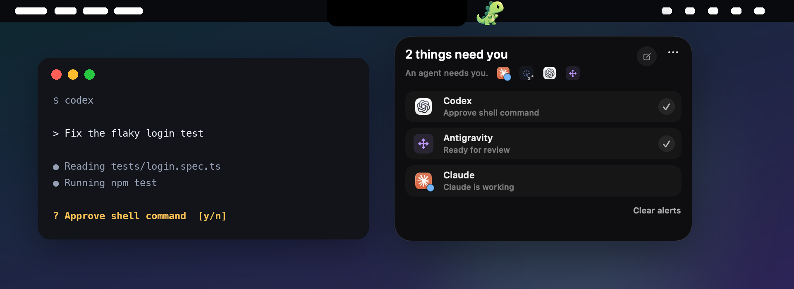
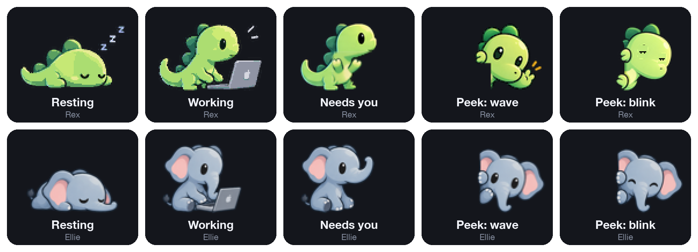
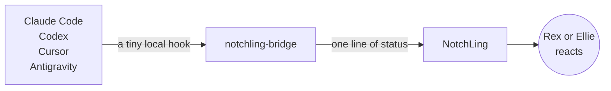
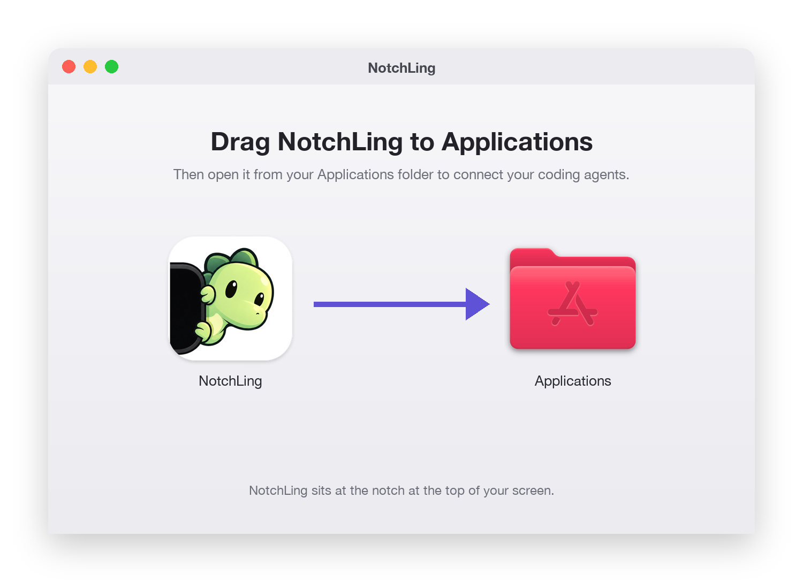
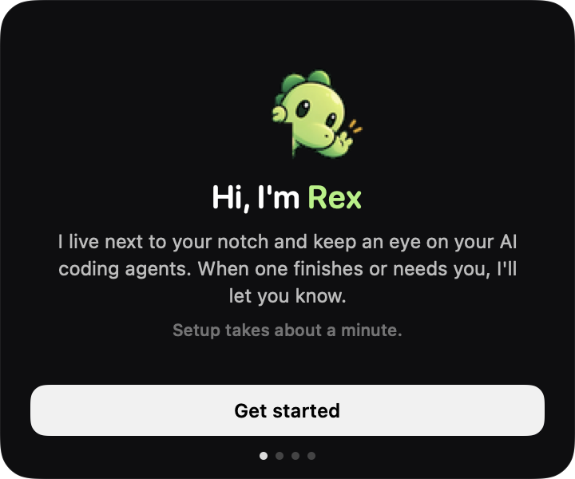
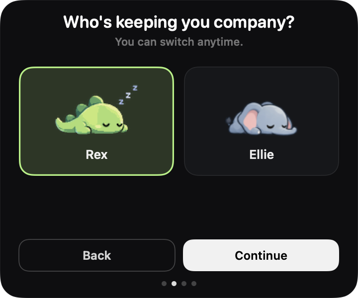

<p align="center">
  
</p>

<h1 align="center">NotchLing</h1>

<p align="center">
  <b>Your AI coding agents, at a glance.</b><br>
  A tiny pet beside your MacBook notch. It naps while nothing runs, works when an agent works, and waves when one needs you.
</p>

<p align="center">
  <a href="../../releases/latest"></a>
</p>

<p align="center">
  
  
  
  
</p>

---

## Meet your NotchLing

<p align="center">
  
</p>

Pick **Rex** the T-Rex or **Ellie** the elephant from **••• → Appearance…**. They share the same moves, so you always read them the same way.

## How it works



Everything happens on your Mac. NotchLing needs no account and no API keys, and it never asks for Screen Recording, Accessibility or Full Disk Access.

## Set up in under a minute

<table>
  <tr>
    <td align="center" width="33%"></td>
    <td align="center" width="33%"></td>
    <td align="center" width="33%"></td>
  </tr>
  <tr>
    <td align="center"><b>1.</b> Drag it to Applications</td>
    <td align="center"><b>2.</b> Open it</td>
    <td align="center"><b>3.</b> Pick a companion, then connect your tools</td>
  </tr>
</table>

## Works with

| Agent | Where it works |
|---|---|
| **Claude Code** | Terminal, and the Code tab in the Claude desktop app |
| **Codex** | Codex CLI and the ChatGPT desktop app. Trust the hooks once in Codex **Settings → Hooks** |
| **Cursor** | Cursor's agent hooks |
| **Antigravity** | Antigravity's agent hooks |

> [!NOTE]
> Chats that don't run hooks aren't supported. That includes regular Claude and ChatGPT chats outside Claude Code and Codex.

<details>
<summary><b>Requirements</b></summary>

<br>

macOS 14 (Sonoma) or later, on a MacBook with a notch. Apple Silicon and Intel are both supported.

</details>

<details>
<summary><b>Uninstall</b></summary>

<br>

1. Open **••• → Connections…** and click **Disconnect** on each tool. This removes NotchLing's hooks from your agents' settings.
2. Quit NotchLing from the **•••** menu and move it to the Trash.
3. Optional: delete `~/Library/Application Support/NotchLing`.

You can also remove every hook from Terminal before trashing the app:

```bash
/Applications/NotchLing.app/Contents/Helpers/notchling-bridge uninstall all
```

</details>

<details>
<summary><b>Build from source</b></summary>

<br>

```bash
xcodebuild -project NotchLing.xcodeproj -scheme NotchLing -configuration Release build
./Scripts/check-notchlings && ./Scripts/test-integrations
```

</details>

## License

[MIT](LICENSE)
