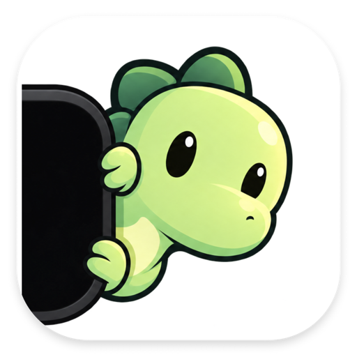

<p align="center">
  
</p>

<h1 align="center">NotchLing</h1>

<p align="center">
  A tiny companion beside your MacBook notch that shows what your AI coding agents are doing.
</p>

<h3 align="center">
  <a href="../../releases/latest">⬇️ Download for macOS</a>
</h3>

## What it does

Pick **Rex** the T-Rex or **Ellie** the elephant from **••• → Appearance…**. They sit by the notch and show your agents' state at a glance:

- **Resting**: nothing is running, so your companion naps.
- **Working**: at least one agent is busy.
- **Needs you**: a brief alert when an agent needs input, finishes, or hits an error. The alert stays in the panel afterwards.
- **Peeks**: an occasional wave or blink. Never a status signal.

Click your companion to open the agent panel. Right-click for Quick Note or to quit.

## Supported agents

- **Claude Code**, including the Code tab in the Claude desktop app.
- **Codex**, including the ChatGPT desktop app. Trust NotchLing's hooks once in Codex **Settings → Hooks**, or Codex ignores them.
- **Cursor**
- **Antigravity**

Chats that don't run hooks aren't supported. That includes regular Claude and ChatGPT chats outside Claude Code and Codex.

## Install

1. Download the latest `.dmg` from [Releases](../../releases/latest) and open it.
2. Drag **NotchLing** to **Applications**, then open it.
3. The first launch walks you through picking a companion and connecting the tools it finds. Change them anytime from **••• → Connections…**.

**Requirements:** macOS 14 (Sonoma) or later, and a MacBook with a notch.

## Privacy

NotchLing runs entirely on your Mac. It needs no account and no API keys, and it never asks for Screen Recording, Accessibility or Full Disk Access. Agents call small local hooks when something happens, and NotchLing reads that local status.

## Uninstall

1. Open **••• → Connections…** and click **Disconnect** on each tool. This removes NotchLing's hooks from your agents' settings.
2. Quit NotchLing from the **•••** menu and move it to the Trash.
3. Optional: delete `~/Library/Application Support/NotchLing`.

You can also remove all hooks from Terminal before trashing the app:

```bash
/Applications/NotchLing.app/Contents/Helpers/notchling-bridge uninstall all
```

## Build from source

```bash
xcodebuild -project NotchLing.xcodeproj -scheme NotchLing -configuration Release build
./Scripts/check-notchlings && ./Scripts/test-integrations
```

## License

[MIT](LICENSE)
